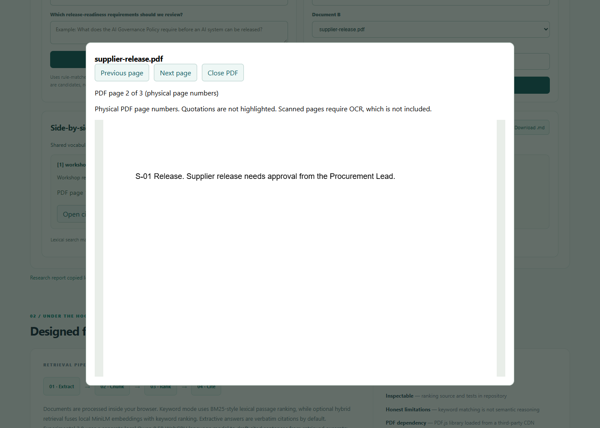

# GroundedDesk AI

**Free, browser-first document intelligence portfolio project.** Upload text, Markdown or text-based PDF documents, inspect source-backed answers, optionally enable local semantic embeddings and a local small language model, and create multi-document research reports.

**[Live GroundedDesk AI 5.6](https://arjun9669.github.io/GroundedDesk-AI/?build=20261012-r33)** · [Engineering case study](./docs/CASE_STUDY.md) · [Security and privacy boundaries](./docs/SECURITY.md) · [Change history](./CHANGELOG.md) · [Author](https://github.com/arjun9669)

> This is the **dedicated source repository and live static site**, deployed through free GitHub Pages. The app runs its own [GitHub Actions CI](./.github/workflows/ci.yml) and [Pages workflow](./.github/workflows/pages.yml). The original profile-hosted demo remains available separately. Model and PDF dependencies require public downloads when enabled; no paid inference account is needed.

## Current release and measured evidence

Current retrieval build: **2026-10-12-r33** (5.6, polished research desk; retrieval behavior unchanged). The dedicated repository is the active development source; the profile-hosted copy is historical.

[Browser benchmark history](./docs/BROWSER_BENCHMARK_HISTORY.md) preserves first-look results separately from in-sample regressions. Aster32 and Lantern32 each reached 32/32 strict passes in the measured r25 regression; this is not independent accuracy. The Aster H01 infrastructure retry qualification remains recorded.

## Features

| Milestone | Capability | Execution |
| --- | --- | --- |
| 1.0 | Browser file intake, BM25-style passage ranking, verbatim citations, Markdown evidence reports | Local JavaScript |
| 2.0 | Optional MiniLM q8 semantic embeddings, cosine similarity and reciprocal-rank hybrid retrieval | Local WASM via Transformers.js |
| 3.0 | Optional small Qwen2.5 0.5B WebGPU generative drafts with structurally verified source IDs, fallback extracts and session conversation | Local WebGPU; device support required |
| 4.0 | Multi-document keyword research, comparison, source-coverage gaps, basic instruction-shaped-text warnings and export | Local deterministic research workflow |
| **5.0** | **Measured on-device keyword evaluation dashboard, strict citation integrity gating, stale-result prevention, detailed case study and regression tests** | **Local JavaScript and GitHub Actions** |
| **5.1 Phase 1** | **Dedicated multi-section policy evidence scanning, numbered-clause grouping, bounded quotations, coverage limitations and Markdown export** | **Separate local deterministic Research workspace; Keyword mode unchanged** |
| **5.2 prototype** | **Candidate release-control inventory: rule-tagged, literal source sentences grouped by gate, conditional, related governance and unclassified categories** | **Optional numbered-policy Research workflow; not semantic synthesis or compliance verification** |
| **5.3** | **Precise source-sentence evidence selection, stronger missing-fact refusals and two-document comparison quote recovery** | **Deterministic Keyword/Comparison refinement, no LLM or paid API** |
| **5.4 / r25** | **More complete source-literal answers, conditional evidence selection and unsupported-value safeguards** | **Actual MiniLM in-sample regressions recorded separately from independent first looks** |
| **5.6 / r33** | **Ask / Compare / Research tabs, document sidebar, progressive settings, responsive controls and preserved evidence** | **Local HTML/CSS/JavaScript; existing retrieval and workflows** |
| **5.5 / r30** | **Verified physical PDF page citations, original-page preview and normalized TXT/Markdown line references in Q&A, Comparison, Research and policy workflows** | **Local PDF.js preview, source-integrity guards and portable Markdown exports** |

No paid model inference, authentication, cloud database or backend is part of this educational reference implementation. Public model/CDN files must be downloaded when enabling semantic, local generation or PDF parsing; those downloads are not entirely offline. The app does not intentionally upload user document contents to a backend.

## 5.6 — A simpler document workspace

The workspace pairs a dark forest-green source library with warm paper colors, editorial headings and an original document illustration. **Ask / Compare / Research** keeps each task focused; numbered citations and readable source cards keep the evidence within reach. System fonts and inline SVG add no external asset downloads or paid dependencies.

- **Add documents:** Browse or drop PDF, TXT or Markdown files into the sidebar. Use the file filter, remove a file, or open its original PDF. Full filenames are available on hover; small files show readable character counts.
- **Ask:** The question box sits above answers and stays visible in short laptop windows. Enter a question, read the quoted answer and inspect its sources. Copy or **Save report** to keep the evidence. Changing tabs preserves your answer and form input. Example questions disappear when the sample documents are replaced.
- **Compare:** Choose two documents and a topic. Their source quotations appear side by side. Comparison remains a separate lexical workflow.
- **Research:** Gather passages across files. Open **Policy review tools** for **Review policy sections** or **Build a policy checklist**. Reports stay associated with their tool tab.
- **Search & answer settings:** Fast keyword search works immediately. Enable the free local MiniLM model for **Local AI search** in Ask. Experimental Qwen draft controls are under a separate disclosure and stay off by default.
- **Smaller screens:** The layout stacks without horizontal overflow. Use **Hide files / Show files** to make room for an answer. File controls restore when returning to desktop width.

Retrieval scores are available under **Search details**, with their confidence limitation. Developer evaluation and data-handling explanations are available below the workspace instead of leading the user flow. Keyboard tabs support arrows, Home and End. This is not a claim of a complete accessibility audit.


**Validation:** 253 unit tests and six actual Chromium feature scripts pass. Installed Chrome checks include keyboard navigation, uploads, exports, preserved tab state, associated results, the bundled developer check, document removal, mobile-width collapse/restoration and PDF workflows. Actual local MiniLM controls pass with Qwen off. The unchanged **Cobalt16 in-sample UI regression is 16 PASS / 0 PARTIAL / 0 FAIL**; all source records and copied reports match r30 apart from the build. The original r29 first-look remains **15 PASS / 0 PARTIAL / 1 FAIL**. No new independent accuracy result is claimed. [Scope and evidence](./docs/WORKSPACE_UI_5_6.md).

No paid design service, web font, backend, account or API was added. Physical-phone validation, character-level PDF highlights, OCR and complex layout work remain pending.

## 5.5 — PDF page citations and local preview

Keyword and MiniLM Hybrid Q&A, separate two-document Comparison, multi-document Research, 5.1 policy sections and 5.2 candidate inventories now show physical PDF page numbers for uniquely located displayed quotations. Open the cited page from an evidence card, use next/previous controls, and include the page reference when copying or downloading the evidence report. TXT/Markdown show normalized text line ranges.

Repeated context is labeled **ambiguous**, missing page metadata is **unavailable**, and a missing Comparison match receives no quotation location or page link. Inventory whitespace normalization maps back to original extraction offsets, including quotes spanning pages. The original file remains in this tab's memory; document changes clear research results and close previews.

**Workflow distinction:** Hybrid MiniLM applies to main Q&A. Comparison, Research and policy inventories remain separate lexical workflows. Page provenance checks do not establish semantic relevance, answer completeness, agreement between documents or compliance.

**Validation:** 253 unit tests and the strict offline toy evaluation pass. Installed Chrome tests cover actual PDF.js extraction/preview and each lexical workflow; the Q&A smoke additionally runs actual local MiniLM with Qwen off. See [r27 scope and evidence](./docs/RESEARCH_PAGE_CITATIONS_5_5.md) and the [original r26 slice](./docs/PAGE_PROVENANCE_5_5.md). These feature/regression checks do not constitute a fresh independent accuracy benchmark. Historical Aster/Lantern scores have not been rerun or changed.

Character-level highlighting inside partial PDF text runs, OCR, layout/table reconstruction and broader document/browser coverage remain pending. The 5.5 document-processing roadmap is still in progress.

### Try the source-navigation workflow

1. Clear the three bundled examples and upload your own text-based PDF files.
2. Ask a question in main Q&A. Keyword works immediately; open **Search & answer settings** and enable MiniLM if you want local Hybrid retrieval. Qwen is optional and can remain off.
3. Inspect each quotation's filename and physical page number. Select **Open cited PDF page** to check the original file and its matched quotation regions, where supported.
4. For two files, open **Compare**, select them explicitly and enter a topic. For broader scans, open **Research** or its **Policy review tools**.
5. Copy or download the Markdown evidence report. Review the full source and any omitted-section warnings before relying on it.

Example from the synthetic PDF used in Chrome validation:



### PDF reliability and upload recovery (r28)

Use **View PDF** in the library to inspect any loaded PDF, even when a question has no matching answer. Upload problems now appear beside the upload control and name the affected file. Locked PDFs need an unlocked local copy; damaged PDFs need a fresh export; image-only or empty PDFs need searchable text. OCR is not included.

Mixed PDFs disclose physical pages with no searchable text. Widely separated text rows can trigger a column/table caution, which also appears in evidence reports. This is a heuristic warning: extraction order is unchanged, columns are not reconstructed and table-cell associations are not guaranteed. A missing warning does not prove correct reading order.

Eight fixed synthetic Chrome cases cover mixed pages, repeated text, cross-page evidence, columns, a table, image-only content, damaged bytes and a genuinely encrypted PDF. Their input hashes and expected behavior were saved before testing. These are feature reliability checks, not independent factual accuracy. See [r28 scope and evidence](./docs/PDF_RELIABILITY_5_5.md).

Limits: 5 MB per file, 75 PDF pages, 180,000 extracted characters and 15 documents per session. Optional MiniLM supports at most 72 indexed chunks; large files may exceed browser/device capacity. Original files and extracted text stay in the current tab's memory.

### Quotation highlighting and fallback (r29)

Cited PDF previews now show the exact cited quotation beside the original page and highlight a unique whitespace-normalized match when it covers complete horizontal PDF text runs. Yellow bounds are approximate visual regions, not character-level proof or factual verification. Q&A uses its cited sentence, rather than its wider retrieved context; lexical workflows use their displayed excerpts.

Repeated matches, partial text runs, cross-page quotations, unsupported geometry and missing matches leave the page unmarked with a clear explanation. Navigation clears the previous page's marks. Library **View PDF** remains an ordinary page view. Nothing is uploaded to locate or render highlights.

Seven synthetic highlight scenarios, mobile-width upload/Q&A/preview alignment, the existing eight PDF reliability cases, lexical workflow checks and actual local MiniLM Q&A passed in installed Chrome. Mobile checks use desktop Chrome emulation, not a physical phone. [Scope and browser evidence](./docs/PDF_HIGHLIGHTS_5_5.md).

A separate new **Cobalt16** test was frozen before answers and executed once with real MiniLM: **15 PASS / 0 PARTIAL / 1 FAIL**. The unknown door-PIN question was incorrectly accepted with a document-title citation; no PIN was invented. Three other unsupported questions refused with zero citations. This small self-authored first-look set is not external validation or representative accuracy. Its failure is preserved; no tuning followed this run. [Full first-look report and fixed inputs](./docs/evidence/r29/cobalt16/FIRST_LOOK_REPORT.md).

### Unsupported PIN value requests (r30)

A request for a PIN/door/access-code value now requires an explicitly labeled 4–12 digit value in the cited quotation. A matching document title, a policy mention or unrelated opening hours cannot satisfy it. Operational rotation questions remain available; this is a lexical evidence guard, not a universal credential or factuality verifier.

The unchanged **Cobalt16 in-sample regression** scored **16 PASS / 0 PARTIAL / 0 FAIL** with actual local MiniLM and Qwen off. H09 now refuses with zero citations; the other fifteen displayed answers are unchanged. Four unsupported questions refused, with zero false acceptances or false refusals in this set. All 16 citations had valid provenance and relevance. The **r29 first-look remains 15 PASS / 0 PARTIAL / 1 FAIL** and is preserved above. This regression is not new independent accuracy. [Exact answers and scorecard](./docs/evidence/r30/cobalt16/REGRESSION_REPORT.md).

253 unit tests and the five existing real-Chromium feature scripts passed. Separate installed-Chrome checks confirm that supported fictional PIN values and rotation questions still answer in both Keyword and actual MiniLM Hybrid. [Scope and evidence](./docs/PIN_REFUSAL_5_5.md). Historical Atlas, Meridian, Lantern and Aster scores are unchanged.

### Free project boundaries and next steps

The current implementation uses free static hosting, browser memory and optional public model downloads. It has no mandatory paid API, subscription, account system or database.

Next priorities are broader PDF layout tests and reliable passage highlighting, followed by measured Hybrid retrieval improvements and stronger factual-support checks. Each change should retain prior benchmark records; independent accuracy claims require a new pre-frozen, previously unseen evaluation. OCR and extra local models should remain optional because download size and device memory matter.

## Quick start

The app is a static ES-module website. From the repository root:

```bash
python -m http.server 8765
```

Visit **http://localhost:8765**. Sample documents are included; uploaded files stay in the current browser session's memory. Supported file types: `.txt`, `.md`, `.markdown`, and text-based `.pdf` (PDF.js from a pinned public CDN). Scanned PDFs without selectable text require separate OCR, which is not included. The app limits file and extracted-text size; mobile browsers may struggle with the large optional model.

### Demo questions

- How are AI use cases reviewed before launch?
- Where is document metadata stored?
- How can an office reduce electricity use?
- What is the capital of Mars? *(should refuse when no source covers it)*

In **Research**, gather evidence across the samples. In **Compare**, select **AI Governance Playbook** and **Cloud Architecture Guide**.

### 5.1 Phase 1 — multi-section policy research

In **Research → Policy review tools**, choose **Review policy sections**, select a loaded policy PDF, and ask a broad question such as **“What does the AI Governance Policy require before an AI system can be released?”**. The new workflow scans printed numbered section identifiers (for example G-01 and G-02), chooses up to eight keyword-matching sections, and displays **literal per-section source passages**, section IDs, risk flags, the detected/matching section counts, and any omitted results. Copy or download the resulting Markdown report.

This is a bounded extractive evidence scan, **not** an AI-written complete policy summary, compliance audit, or guarantee that every applicable obligation was found. It currently requires recognizable numbered clause markers; unnumbered policies need a different workflow. Uploaded material remains in browser memory. The normal **Keyword** Q&A mode and its retrieval/citation heuristics are unchanged; choose the separate 5.1 workflow for broader, multi-section questions.


### 5.2 — Candidate release-control inventory (prototype)

In **Research → Policy review tools**, select **Build a policy checklist**, upload/select a numbered policy, and ask: **“What does the AI Governance Policy require before an AI system can be released?”**. Press **Build source-linked checklist** and copy the Research results report. The implementation scans up to **64 numbered sections**, extracts up to **24 literal rule-shaped sentences** (no more than five per section), applies transparent regular-expression categories, and identifies skipped sections, output caps, and instruction-shaped content excluded from checklist generation.

This **does not** verify whether a control has been satisfied, infer exception conditions, assess legal compliance, or guarantee complete requirement recall. The categories are heuristics rather than semantic analysis; some advisory/operational controls can be included and some obligations can be missed. The form only supports **release/deployment/launch/readiness** prompts, not arbitrary policy question answering. Documents without recognizable numbered clauses have no supported result. Keep the full original document alongside every exported report. No paid API, server, vector DB, or LLM is involved.

**QA status:** Source-code, unit and Chromium UI checks passed in GitHub CI. The tester's original Atlas PDF 5.2 export has been [manually reviewed and recorded](./docs/VALIDATION_5_2_ATLAS.md) as **one single-PDF smoke-test pass**, not a complete or independently instrumented browser test. The [15-question Atlas baseline](./docs/ATLAS_15_QUESTION_BASELINE.md) has now been run using the separate Keyword/Comparison workflows, **not** using the 5.2 release-control checklist; the results must not be presented as 5.2 answer accuracy. See [evaluation protocol](./docs/EVALUATION_PROTOCOL.md).

### 5.3 — evidence precision and refusal reliability

The default Keyword engine now favors whole source sentences from retrieved documents, and separate Comparison mode searches literal passages within both selected files rather than discarding evidence due to full-question BM25 chunk thresholds. Explicit missing-attribute requests are conservatively refused; this is **not** guaranteed claim-level semantic checking. Multi-part questions may include bounded, contiguous source statements rather than unsupported paraphrases. Existing 5.1 multi-section and 5.2 release-control workflows remain opt-in and unchanged in purpose.

The [Atlas 15-question original-PDF-text retest](./docs/ATLAS_15_QUESTION_5_3_RETEST.md) found **15/15 evidence-supported or appropriately refused** under the test-set's strict rubric, compared with the [previous 9 PASS / 4 PARTIAL / 2 FAIL](./docs/ATLAS_15_QUESTION_BASELINE.md) baseline. **This is an in-sample synthetic regression result, not independent real-world accuracy, production readiness, or a mobile PDF upload test.** The feature code was iteratively tuned using these failure cases; new unseen documents require separately labeled evaluation.

### 5.3.1 — Hybrid unsupported-attribute refusal patch

The Windows Chrome manual test identified a **Hybrid-mode false acceptance** when a missing database password was answered with three unrelated Atlas PDF cover citations.

**Manual retest result (2026-10-10): PASS for the original password-refusal case.** On build `2026-10-10-r16`, Windows Chrome Hybrid MiniLM + BM25 returned an explicit refusal with **zero cited sources**. The [validation record](./docs/HYBRID_REFUSAL_5_3_1.md) preserves both the r15 failure and r16 success. This does **not** establish reliable refusal behavior across other Hybrid questions. The r15 **15/15** Atlas baseline tested **Keyword and document comparison only**, not Hybrid. In r16, the conservative specific-attribute evidence guard also applies to Hybrid RRF results. This is not a full semantic entailment verifier.

See the [observed failure and successful Chrome retest](./docs/HYBRID_REFUSAL_5_3_1.md). Automated regression tests still use mock vectors and cannot establish actual MiniLM accuracy.

### 5.3.2 — Hybrid complete-source evidence correction (r17)

A **separate actual Windows Chrome test on r16** of the original Atlas 15 questions found **12 PASS / 1 PARTIAL / 2 FAIL** across Hybrid Q&A (8/11 full passes) and lexical Comparison (4/4 passes). The observed Hybrid defects were **D03** (missed 95% provenance target), **D06** (lost legal-hold exception after `unless`) and **D08** (incorrect high-risk vendor approval). Other answers carried irrelevant but source-literal quotes. See the [preserved r16 test baseline](./docs/ATLAS15_R16_CHROME_HYBRID_BASELINE.md). This real-browser baseline supersedes any inference that the earlier **offline Keyword 15/15** score also applied to Hybrid.

In r17, Hybrid can recover a **complete exact source sentence** from a retrieved document when a strong lexical match exists, instead of relying on a potentially truncated MiniLM-ranked chunk. Weak extra citations in non-comparison questions are pruned conservatively; explicit multi-document workflows remain separate. Semantic-only paraphrases fall back to existing chunk extraction. All relevance measures remain heuristics, **not entailment verification**.

**Actual Windows Chrome r17 retest (2026-10-11):** The [tester-submitted original Atlas 15 report](./docs/ATLAS15_R17_CHROME_HYBRID_RETEST.md) records **15 PASS / 0 PARTIAL / 0 FAIL** under the unchanged answer-completeness rubric: **11/11 Hybrid Q&A** and **4/4 separate lexical Comparison**. All three refusals cite zero sources; **18/18 quotations** are reported source-literal. **D02 still contains two irrelevant secondary citations**, so this is not clean citation precision or an independent real-world accuracy estimate. The prior r16 **12 PASS / 1 PARTIAL / 2 FAIL** record remains unchanged. Automated regression tests use deterministic mock vectors; the new result is separately labeled as a reported real-Chrome MiniLM run.

### 5.3.3 — Hybrid secondary-citation precision (r18)

The original r17 Chrome MiniLM Atlas 15 run achieved **15/15 answer-completeness passes**, but D02 showed two unnecessary Runbook/Vendor quotations alongside the correct Governance evidence-package sentence. The [r17 result](./docs/ATLAS15_R17_CHROME_HYBRID_RETEST.md) remains unchanged, including the **14/15 cases with all citations relevant**.

In r18, single-topic Hybrid answers remove extra citations when the leading literal answer quote strongly covers multiple material question terms, even if its heuristic relevance score is only moderately strong. The Keyword pruning threshold stays unchanged. Explicit comparison intent and semantic-only multi-source paraphrases remain protected. The change uses **lexical heuristics, not semantic entailment**.

**Actual Chrome r18 acceptance (2026-10-11):** The [user-supplied real MiniLM Atlas 15 report](./docs/ATLAS15_R18_CHROME_HYBRID_ACCEPTANCE.md) records **15/15 full passes**, **15/15 cases with all citations relevant**, and **16/16 literal quotations**. D02 now shows exactly one Governance citation with the complete five-item package; D03/D06/D08 and all three zero-citation refusals remain correct. The 11 Q&A cases used real MiniLM Hybrid and 4 separate comparison cases used lexical Comparison. This is **known-corpus, in-sample acceptance**, not generalizable production accuracy. **A separate first held-out Meridian 24 Chrome test has now run and FAILED: 16 PASS / 4 PARTIAL / 4 FAIL (66.7% strict), including 2/4 unsupported questions incorrectly accepted and 22/26 relevant citations.** The [frozen first-look report](./docs/MERIDIAN24_R18_FIRST_HELDOUT_BASELINE.md) preserves all cases and original source hashes. Atlas's in-sample 15/15 is not generalizable accuracy. [Release plan](./docs/HYBRID_D02_R18_PLAN.md).

### 5.4 — unsupported concrete-value evidence guards (r19)

The first **frozen previously unseen Meridian 24** browser test on r18 scored **16 PASS / 4 PARTIAL / 4 FAIL**, with **2/4 deliberate unsupported questions incorrectly accepted** despite literal quotations. The [historical r18 first-look](./docs/MERIDIAN24_R18_FIRST_HELDOUT_BASELINE.md) is preserved.

r19 makes a **narrow safeguard** for explicit requests for a bank account identifier or a numeric engineering torque setting. A heading containing the organization's name and a list mentioning a torque marker are no longer accepted as evidence of those missing values. Positive examples with literal account identifiers or torque numbers and units remain answerable. The check examines the **displayed quotation**, not just search ranking or its expanded excerpt.

This does **not** fix the other six known Meridian cases (I07, I09, I10, I15, I18, I20), and is not general semantic validation. **Real Chrome r19 regression (2026-10-11):** The [actual MiniLM retest](./docs/MERIDIAN24_R19_CHROME_REGRESSION.md) scored **18 PASS / 4 PARTIAL / 2 FAIL (75%)** against the unchanged frozen Meridian 24, improving from r18's preserved **16/24 first-look**. Both I23/I24 now correctly refuse with **zero citations**, and all 16 previous passes were preserved. This is **in-sample regression**, not new held-out accuracy; I07 and I10 still fail, while I09/I15/I18/I20 remain partial. Mock-vector tests and [r19 plan](./docs/MERIDIAN_R19_UNSUPPORTED_VALUES.md) remain separate supporting checks.

### 5.4 — operative approval and dispatch evidence selection (r20)

The frozen Meridian24 r19 real Chrome regression remained **18/24 PASS** with two direct incorrect answers: **I07** selected the lower approval band for a request above its upper threshold; **I10** quoted the dispatch cutoff instead of the explicit next-operating-day rule for an order released later than the cutoff.

r20 adds narrow source-literal clause selection for purchasing approval **numeric inequalities** and a **post-cutoff dispatch departure** backed by an explicit next-day sentence in the retrieved source. These checks use the original document text and never synthesize missing actors or dates; other semantic-only Hybrid paths retain their fallback. Generalized mock-vector tests cover different thresholds, exact boundaries and cutoff times. The four partial cases I09/I15/I18/I20 remain open.

**Actual r20 Chrome acceptance (2026-10-11):** The [user-supplied real MiniLM Meridian 24 regression report](./docs/MERIDIAN24_R20_CHROME_REGRESSION.md) shows **20 PASS / 4 PARTIAL / 0 FAIL (83.3% strict)**, with I07 and I10 corrected and all 18 earlier r19 passes preserved. All four unsupported questions refused with zero citations; **24/24 quotations were authentic and 23/24 relevant**. Four incomplete cases I09/I15/I18/I20 remain. This is **in-sample regression**, not new held-out accuracy. The original r18 first unseen **16/24** and r19 regression **18/24** are preserved. [r20 scope and acceptance plan](./docs/MERIDIAN_R20_OPERATIVE_CONDITIONS.md).

### 5.4 — Bounded Hybrid qualification context (r21)

The latest real Chrome Meridian24 r20 regression scored **20 PASS / 4 PARTIAL / 0 FAIL** with genuine MiniLM Hybrid Q&A plus separate lexical Comparison. Two Hybrid partials are **I09** (supplier acknowledgement did not include the adjacent *not a delivery guarantee* qualifier) and **I15** (dusty-bay lubrication 30 hours without the standard 60-hour or unchanged inspection context).

r21 can append at most one immediately adjacent sentence on each side of a strong Hybrid quote, **only** for relevant acknowledgement disclaimers or changed-interval baseline/unchanged conditions, inside the same source section and within a 620-character exact contiguous quotation. r20's numeric approvals and post-cutoff selection remain protected. The code does not change lexical Comparison, so **I18/I20 remain open**.

**Actual Chrome r21 regression (2026-10-11):** The [user-supplied real MiniLM r21 Meridian24 retest](./docs/MERIDIAN24_R21_CHROME_REGRESSION.md) scored **21 PASS / 3 PARTIAL / 0 FAIL (87.5% strict)** against the *same* frozen test set. I09 now includes the six-business-hour deadline and the explicit **not a delivery guarantee** qualification. I15 improved to include both normal 60h and dusty-bay 30h but **still omits unchanged inspection frequency**; I18 and I20 lexical Comparison remain partial. All 20 prior r20 passing cases remain PASS. 24/24 quotes were source-literal, 23/24 relevant, and all four unsupported refusals had zero citations. **In-sample regression, not newly held-out accuracy.** [r21 engineering scope](./docs/MERIDIAN_R21_HYBRID_ADJACENT_CONTEXT.md).

### 5.4 — Bounded complete Hybrid and Comparison evidence (r22)

The actual Chrome r21 Meridian24 **in-sample regression** achieved **21 PASS / 3 PARTIAL / 0 FAIL**, with I15 lacking unchanged inspection context, I18 omitting an investigation hold, and I20 citing purchase-record retention instead of purchase packet items.

r22 expands interval evidence only across **consecutive relevant, same-section, source-literal sentences** (up to 620 characters). Separately, lexical Comparison now distinguishes **packet contents** from retention when selecting each side, and can include an immediately adjacent, same-section retention exception when the user asks for exceptions. Unrelated sentences, different printed sections and unsupported facts must not be interpolated. The Hybrid and lexical Comparison workflows remain distinct.

**Actual real Chrome r22 regression (2026-10-11):** The [user-supplied MiniLM Meridian24 r22 report](./docs/MERIDIAN24_R22_CHROME_REGRESSION.md) records **23 PASS / 1 PARTIAL / 0 FAIL (95.8% strict)** on the unchanged frozen Meridian corpus. **I18 and I20 Comparison now PASS**, with both retention exceptions and both packet-content lists, respectively. **I15 still PARTIAL**: normal 60h and dusty-bay 30h displayed, unchanged inspection interval not displayed. All 21 earlier r21 passes preserved; **24/24 source-literal and directly relevant quotes**, **4/4 zero-citation unsupported refusals**. This is **post-tuning in-sample regression, NOT independent unseen accuracy**; the original r18 first-unseen 16/24 and r19/r20/r21 regression 18/24, 20/24 and 21/24 remain unchanged. [r22 scope](./docs/MERIDIAN_R22_COMPLETE_EVIDENCE.md).

### r23 — Applicable time conditions and unsupported-contact safeguards

The new [Lantern32 first-look](./docs/LANTERN32_R22_FIRSTLOOK_RESULTS.md) scored **16 PASS / 12 PARTIAL / 4 FAIL out of 32** on **unchanged r22**, with three directly wrong or unsupported outcomes (wrong refund band H06, wrong instructor cancellation cutoff H21, unsupported personal mobile citation H24) and one heading-only retry answer (H18).

r23 introduces narrow extractive safeguards: match **inclusive/exclusive hours-before cancellation rules**; require the **correct before/after clock condition**; demand a printed plausible phone number and, for a named holder, the same holder in the quote; and recover adjacent **failed retry + escalation** sentences or refuse heading-only evidence. R20–r22 approvals, dispatch, exceptions and refusal tests remain in CI. This is **not semantic entailment** and does not resolve the 11 incomplete Hybrid cases or lexical Comparison X31.

**Actual Chrome MiniLM r23 result is pending.** New Node tests use mock Hybrid vectors. Preserve Lantern32's original 16/32 unseen first-look and Meridian r18's original 16/24 unseen first-look; any post-r23 Lantern32 retest is **in-sample**. [r23 engineering scope and acceptance gate](./docs/LANTERN_R23_SAFETY_GATES.md).

### Evaluate the actual retrieval

Open the **5.0 Engineering Quality Gate** and press **Run local evaluation**. It executes 28 labeled keyword queries on the original three fictional sample documents and shows top-1 source match, out-of-domain refusal rate, provenance errors, **warmed-up repeated keyword timing in microseconds**, and per-case verdicts with a JSON download. The microbenchmark times 10 representative questions in batches lasting at least 40 ms, avoids misleading 0.000 ms one-shot displays, and reports median/p95 across batch-average timings—not individual-request tail latency. If you add or remove files, reload to restore the original sample corpus before evaluating. **These scores do not test MiniLM/Qwen accuracy or real-world hallucination rates.** See the [evaluation methodology and manual real-document test protocol](./docs/EVALUATION_PROTOCOL.md) for exact measurements and limitations.

### Browser cache and evidence-report build version

GitHub Pages and iPhone in-app browsers may cache JavaScript modules across quick successive deployments. The updated Keyword retrieval engine identifies itself as build `2026-10-11-r23`, and the 5.3 browser entrypoint plus its direct retrieval-related imports use fingerprint `20261011-r23`. Source/CSS URLs are fingerprinted so updated HTML loads matching app modules. Each evidence report now states its **Retrieval build** and **Retrieval mode**. The footer also displays the loaded build.

To verify an Atlas PDF regression fix, reopen [the live demo with a unique page query](https://arjun9669.github.io/GroundedDesk-AI/?build=20261011-r23), clear the original TXT samples, upload the PDFs again, select **Keyword** mode, and regenerate the report. A report missing the build field may have been copied from an earlier cached tab. Score and source matching are still heuristic; one cited exact quote does not establish that an entire answer is complete.

### Independent unseen benchmark frozen after r22

**Independent Lantern32 r22 FIRST-LOOK (2026-10-11): 16 PASS / 12 PARTIAL / 4 FAIL (16/32 = 50% strict)** on four newly frozen fictional museum-domain documents. **Real MiniLM Hybrid Q&A: 11/26 PASS; separate lexical Comparison: 5/6 PASS.** The four direct failures were H06 (wrong refund branch), H18 (heading-only snapshot answer), H21 (wrong after-17:00 cancellation branch), and H24 (unsupported personal-mobile question cited an irrelevant approval rule). Only **3/4 zero-citation unsupported refusals** were correct. All **35/35 quotations were source-authentic**, but **31/35 directly relevant**. The 11 other Hybrid partials expose missing adjacent requirements and exceptions. [Complete immutable first-look result and scorecard](./docs/LANTERN32_R22_FIRSTLOOK_RESULTS.md).

[Original pre-test Lantern32 freeze attestation and immutable grading protocol](./docs/LANTERN32_R22_FIRSTLOOK_FREEZE.md) remains unchanged. The first-look Chrome run used the original sealed rubric, exact files, local MiniLM and Qwen off. **Lantern32's 16/32 first-look and Meridian's 23/24 post-tuning result are distinct benchmarks and not directly comparable as a before/after change.** Future Lantern32 retests are in-sample regressions; the known Meridian I15 partial remains open. No retrieval code has been altered by this documentation update.

## Tests and evaluation

Manual QA: [GroundedDesk AI 5.1 Phase 1 Atlas single-PDF validation record](./docs/VALIDATION_5_1_PHASE1.md) — one source-inspected 2026-10-10 smoke test, **not** an exhaustive policy-audit or cross-browser benchmark.

5.2 manual QA: [Atlas single-PDF candidate-control validation](./docs/VALIDATION_5_2_ATLAS.md) — 8 sections inspected, 17 literal quotes manually compared, **not** a 15-question benchmark or release-compliance certification.

**Atlas 15-question original-PDF-text evaluation:** [5.3 retest 15/15 in-sample](./docs/ATLAS_15_QUESTION_5_3_RETEST.md), compared with [the 9 PASS / 4 PARTIAL / 2 FAIL baseline](./docs/ATLAS_15_QUESTION_BASELINE.md) — the measured *offline* Keyword/Comparison evaluation on three fictional Atlas source PDFs. This is a development regression baseline, not verified real-world accuracy or mobile-PDF ingestion testing. The baseline Keyword false acceptance was corrected in r15; an additional **Hybrid-mode false acceptance** was subsequently observed on Windows Chrome and is tracked in [the r16 fix record](./docs/HYBRID_REFUSAL_5_3_1.md).

Install **Node.js 22+** for checks (no npm dependencies needed for the local retrieval test suite):

```bash
node --test tests/*.test.mjs
node --check app.mjs
node --check quality.mjs
node --check benchmark.mjs
node --check retrieval.mjs
node --check semantic.mjs
node --check hybrid.mjs
node --check generation.mjs
node --check research.mjs
node --check policy-synthesis.mjs
node --check report.mjs
node eval/run.mjs --strict
node eval/run.mjs --json > evaluation.json
```

The included [GitHub Actions CI](./.github/workflows/ci.yml) runs the same checks, including 5.0 provenance and dashboard integration tests, and archives the toy-corpus report. During the v4 release, **39 tests passed** in the dedicated repository ([verified Actions run](https://github.com/arjun9669/GroundedDesk-AI/actions/runs/38019249606)). The 5.0 branch adds additional tests and CI will re-run the full suite before merging. That run exercised deterministic retrieval, math with **mock embeddings**, prompt/citation structure with **mock model outputs**, research provenance and small sample documents. It did **not** run real downloaded MiniLM or Qwen weights or establish real-world answer accuracy. The browser UI contains optional device-specific model evaluations.

The small bundled evaluation corpus uses **18 supported and 10 unrelated queries** against fictional examples, not a held-out real-world benchmark. The 5.0 dashboard and CLI verify source identities, citations, and excerpts but do not assess semantic entailment. Do not present curated scores as model accuracy, prompt-injection immunity, or production reliability.

## Technical flow

```text
User's files / sample documents
       │
Browser PDF/text extraction and in-memory chunks
       │
       ├── Keyword retrieval (BM25-style, default)
       ├── Optional local MiniLM q8 embeddings → cosine ranking
       └── Optional weighted reciprocal-rank fusion
       │
Verbatim source excerpts + clickable citations
       ├── Default: extractive evidence
       ├── Optional local Qwen WebGPU cited draft
       │     (citation format checked; factual entailment NOT proved)
       └── Scripted multi-document research / comparison reports
```

## Limitations and security

This is an **educational/portfolio prototype, not a production-ready RAG or security product**. Lexical and semantic results can be irrelevant, and a valid citation ID does not prove that generated text is supported. The simple pattern-based warning for prompt-injection-like text is not a comprehensive detector. Research reports show literal document excerpts and gaps; shared words alone do not prove agreement or contradiction. Validate answers against the excerpts before using them in decisions.

Model availability, downloaded weights, memory limits, browser WebGPU/WASM support, and performance vary by device. Uploaded content is in browser memory, but downloaded/exported reports and clipboard contents can contain private data. Avoid uploading confidential material to a public demo without independently reviewing your browser and extension environment.

## Source and deployment

This standalone-ready snapshot was prepared from [the verified GroundedDesk code inside the profile repository](https://github.com/arjun9669/arjun9669/tree/main/projects/groundeddesk-ai). The dedicated repository is the active source for **https://arjun9669.github.io/GroundedDesk-AI/**. The `.github/workflows/pages.yml` workflow publishes every successful `main` push after Pages is configured to use GitHub Actions. The earlier profile-hosted Pages demo remains available but is not automatically updated by this repository.

No specific software license has been granted in this snapshot. Add an appropriate license only after the repository owner chooses one.
