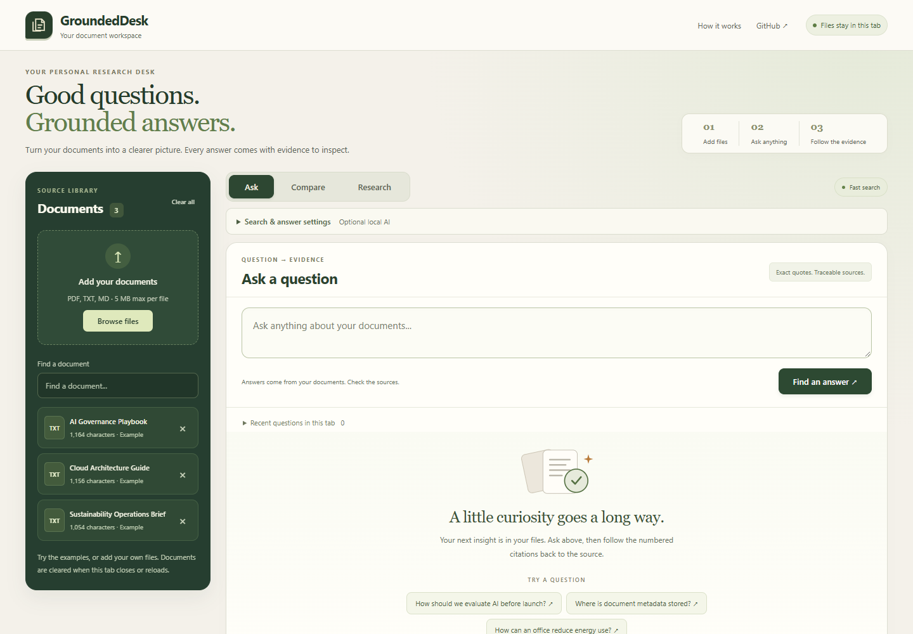

# GroundedDesk AI

**Ask questions about your documents, inspect the quotations, and open the original evidence—all in your browser.**

GroundedDesk is a free document intelligence portfolio project built with HTML, CSS and JavaScript. Start with Keyword search, optionally enable on-device MiniLM Hybrid retrieval, or compare documents using separate lexical tools. No account, paid inference API or application backend is required.

**[Open the live app](https://arjun9669.github.io/GroundedDesk-AI/?build=20261013-r44)** · [Engineering case study](./docs/CASE_STUDY.md) · [Security and privacy](./docs/SECURITY.md) · [Changelog](./CHANGELOG.md)

## Current status

| Area | Status |
|---|---|
| Live application | **GroundedDesk 5.6**, retrieval build **`2026-10-13-r44`** |
| Latest retrieval experiment | **v35** exposed675 gate **PASS**; engineering review **PASS**; not adopted |
| Latest recorded checks | **540 frozen unit tests**, strict bundled checks; original quotation probe replay **PASS**; actual MiniLM recorded separately |
| Hosting and inference | Free GitHub Pages hosting; optional models run on device after public downloads |
| Release maturity | Educational prototype; **6.0 readiness has not been established** |

The isolated [v35 real Chrome/MiniLM regression](./docs/COVERAGE_V35_R44_VALIDATION.md) records native gate **PASS** and engineering review **PASS** across 675 exposed cases. Hearth32 records **32/0/0 fixed / 32/0/0 section** under its unchanged key/rubric. [Exact answers and JSON scorecards](./docs/evidence/coverage-v35-r44/ALL_SCORECARDS.json) preserve every result and regression. **Live 5.6/r44 remains unchanged; v35 is not adopted.**

V35 preserves an already-complete uniquely anchored literal maintenance quotation before considering context expansion. Its parser and Hybrid functions remain unchanged. The original v34 synthetic quotation probe now records **PASS** in a separately reported frozen engineering replay, outside the 675 browser cases. Eligible only to prepare a separately frozen prospective confirmation in a later task; no fresh sample was created here. Candidate adoption, integration review and 6.0 readiness remain unestablished.

The run used 627 actual local MiniLM Hybrid questions and 48 separate lexical Comparisons, Qwen off, installed headless Chrome. This is in-sample regression, not independent accuracy or 675/675; different rubrics are not pooled. Older public-set failures remain visible. Performance, memory, citation-navigation and export integration readiness and 6.0 readiness remain unestablished.

[V34's original native PASS, Hearth32 32/0/0 and engineering HOLD](./docs/COVERAGE_V34_R44_VALIDATION.md) remain unchanged, including its original post-seal probe FAIL. [V33's first FAIL/Hearth32 31/1/0](./docs/COVERAGE_V33_R44_VALIDATION.md), [Hearth32's original v32 BLOCKED/ungraded first attempt](./docs/HEARTH32_V32_CONFIRMATION.md), all older first scores, failed gates and explicit reporting errata are preserved. No first result is replaced or retrospectively rescored.

## Try it in a few minutes

1. [Open GroundedDesk](https://arjun9669.github.io/GroundedDesk-AI/?build=20261013-r44). Try the bundled examples, or clear them and choose your own files.
2. Use **Ask** for a question, **Compare** for two selected documents, or **Research** for a broader lexical evidence scan.
3. Read every quotation and filename. Choose **Open cited PDF page** for a uniquely located PDF quote to inspect the original.
4. Copy or download the Markdown evidence report. For local Hybrid search, open **Search & answer settings** and enable MiniLM. Qwen generation can remain off.

Sample questions:

- How are AI use cases reviewed before launch?
- Where is document metadata stored?
- How can an office reduce electricity use?
- What is the capital of Mars? *(The bundled documents should not support an answer.)*

Use **Quick guide** in the app for a short walkthrough. **Ctrl/Cmd + Enter** submits a question; Enter adds a line.

## What you can do

| Capability | What it provides |
|---|---|
| Document library | TXT, Markdown and text-based PDF intake; readiness feedback, replacement and removal |
| Ask | Keyword or optional MiniLM Hybrid retrieval; search all files or selected files |
| Evidence review | Verbatim quotations, filenames, physical PDF page references and normalized text line references |
| PDF preview | Original-page navigation, desktop side-by-side review and approximate highlights for supported unique text-run matches |
| Compare and Research | Separate lexical excerpts; numbered-policy review and candidate checklists |
| Reports and history | Markdown exports and session question history with the original source selection |
| Optional workspace save | Explicit local document snapshot; restore re-extracts PDFs and starts optional models off |

Comparison, Research and policy tools do **not** use MiniLM Hybrid. Policy checklists are bounded extraction tools, not compliance audits. PDF highlights locate text; they do not verify factual support.



*Historical r33 interface capture. The current live build is r44; this is not a new deployment screenshot.*

## Search and answer modes

| Mode | Execution | Important boundary |
|---|---|---|
| Keyword | Local BM25-style retrieval; available immediately | Can miss paraphrases or select incomplete evidence |
| Hybrid | `Xenova/all-MiniLM-L6-v2` q8 embeddings in local WASM, combined with lexical ranking | Requires a public library/model download; ranking is not factual verification |
| Optional generated draft | Local `onnx-community/Qwen2.5-0.5B-Instruct` through WebGPU | Device support varies; citation ID checks do not prove factual support |

Extractive quotations are the default. Optional models download only when enabled. Initial model/PDF dependency downloads require network access, so the app is not fully offline from first use.

## Files, storage and limits

- **Supported:** `.txt`, `.md`, `.markdown` and PDFs with searchable text. OCR is not included.
- **Intake limits:** 15 documents per session, 5 MB per file, 75 PDF pages and 180,000 extracted characters per document.
- **MiniLM limit:** 72 indexed passages per session; memory and performance vary by device.
- Files stay in browser memory unless you explicitly choose **Keep this workspace → Save on this device**. The snapshot uses this browser's IndexedDB and is not encrypted by the app.
- Snapshots contain documents and Ask selection, not questions, answers, drafts, embeddings or enabled model settings. Save again after changes; clearing browser data may erase the snapshot.
- The app does not intentionally send document contents to a backend. Public dependency downloads, browser extensions, device security and exported reports have separate privacy boundaries. See [Security and privacy](./docs/SECURITY.md).

Readiness describes available extracted text. Blank/scanned pages, reading order, columns and table relationships still need original-document review. Repeated or unsupported quotation locations receive an explanation rather than a fabricated page match.

## Latest measured results

The [Bracken32 report](./docs/BRACKEN32_V25_CONFIRMATION.md) preserves the first **21 PASS / 1 PARTIAL / 10 FAIL** in both unchanged v25 variants on four new fictional documents:28 actual local MiniLM Hybrid questions and4 separate lexical Comparisons, captured once. This is prospective author-created stress testing. A Chrome patch change from155.0.8059.40 to155.0.8059.80 was detected and explicitly amended/frozen before any model, uploads or questions; it qualifies comparison with older runs. All33 quotations are literal, but24 are relevant. Five unsupported controls do not refuse; two supported questions falsely refuse. All4 Comparisons pass. No prior paired-v24 PASS is lost, but two previously incorrect cited answers become false refusals. **Confirmation FAIL; performance/integration qualification stopped.** Preserve this first result; Bracken32 is now exposed for future regression.

The [v25 regression report](./docs/COVERAGE_V25_R44_VALIDATION.md) records **Cedar32 32 PASS / 0 PARTIAL / 0 FAIL** both, after its preserved [first prospective 24/2/6](./docs/CEDAR32_V24_CONFIRMATION.md). A single real headless-Chrome/MiniLM run captured547 unchanged exposed cases:515 Hybrid and32 separate lexical Comparisons. Only six Cedar32 refusals and two Comparison excerpts change; all515 older answers/quotes match paired v24. Cedar32 has29/29 source-literal/relevant citations, all103 unsupported controls refuse uncited, and no prior PASS is lost. Binding64 and historical451 gates remain PASS. Five older public-case failures remain; this is not547/547 or independent accuracy. **V25 is not adopted; live r44 stays unchanged.**

Earlier results remain preserved:

The [v24 follow-up report](./docs/COVERAGE_V24_R44_VALIDATION.md) records **64 PASS / 0 PARTIAL / 0 FAIL** on the unchanged Binding64 rubric in both isolated variants, with no lost prior PASS. It captures the same 515 exposed questions once with real local MiniLM, Qwen off: 487 Hybrid and 28 separate lexical Comparison. F05 is repaired by a unique literal-date fallback inside the selected document, retaining its actual 0.2406 cosine unchanged. F08/C02 fixes from v23 and all 95 unsupported zero-citation refusals remain correct. All 58 Binding64 citations are source-literal, expected-paragraph-contained and include a required frozen span.

Both frozen development gates **PASS**, but this is **in-sample frozen-key compliance**, not 515/515, new independent accuracy or full question entailment. Known temperature wording qualifications remain below. **v24 is not adopted; live r44 stays unchanged pending separately frozen confirmation and integration review.** [Scores and selected evidence](./docs/evidence/coverage-v24-r44/).

V23 and v24 are **two separate 515-case runs with different frozen candidates**. V23's first 63/0/1 was committed and archived before v24 implementation; it is not overwritten or relabelled as a pass:

The [v23 report](./docs/COVERAGE_V23_R44_VALIDATION.md) preserves its first **63 PASS / 0 PARTIAL / 1 FAIL** Binding64 result in both isolated variants. F08 and C02 now display the missing winter-average evidence; F05 still excludes the correct event/date sentence because its actual cosine is 0.2406, below the frozen 0.35 minimum. The same 515 exposed cases were captured once with actual local MiniLM in installed headless Chrome, Qwen off; no prior PASS was lost and all 95 unsupported controls still refuse without citations. Overall gate **FAIL**, r44 unchanged. [Scorecards and selected evidence](./docs/evidence/coverage-v23-r44/).

Frozen-key grades retain wording limits: F07/C02 ask about a monthly temperature while the source/key gives a maximum since WWII; F08/C02 give a winter-average bound, not an absolute low. These results are in-sample development evidence, not independent accuracy or a release.

The [v22 report](./docs/COVERAGE_V22_R44_VALIDATION.md) records the same **515 exposed questions captured once** with actual local MiniLM in installed headless Chrome, Qwen off: 487 Hybrid and 28 separate lexical Comparison cases. **All three v21 regressions are restored**: Norwood's 61-yard return, Orchard's complete departure sentence without filler, and the supported tagging count. Only these three cases change; their displayed quotations exactly match historical v20. No prior PASS is lost, and the historical 451-case gate returns to PASS.

Binding64 reaches **61 PASS / 1 PARTIAL / 2 FAIL** in both isolated variants. All 95 unsupported controls across the sets refuse without citations. Binding64's unchanged F05/F08 failures and C02 incomplete compound keep its strict gate—and the overall gate—at **FAIL**. This is **in-sample regression**, not new independent accuracy. **Live r44 stays unchanged; v22 is not adopted.** [Scorecards and selected browser evidence](./docs/evidence/coverage-v22-r44/).

Previous results remain preserved:

The [v21 report](./docs/COVERAGE_V21_R44_VALIDATION.md) records **515 previously exposed questions captured once** in installed headless Chrome with actual local MiniLM, Qwen off: 487 Hybrid Q&A and 28 separate lexical Comparison. Actual production UI, isolated fixed/section v21 outputs and paired v20 are labelled separately. These are **in-sample regressions**, not new independent accuracy.

Binding64 reaches **60 PASS / 1 PARTIAL / 3 FAIL** in both variants, preserving its qualified v20 first **45/1/18**. All 12 unsupported controls now refuse with zero citations, all eight conditions pass, and all four Comparison cases pass after heading removal; their facts were already complete in v20. But three previous PASS cases regress: **V9Exposed32/F17** (Norwood false refusal), **RetrievalQuality28/RQ02** (truncated subject and irrelevant quotation filler), and **Binding64/T4A** (tagging false refusal). All original 119 and Precision48 remain all PASS. **Both gates FAIL; v21 stays experimental and live r44 is unchanged.** [Scores and selected evidence](./docs/evidence/coverage-v21-r44/).

The [Binding64 confirmation report](./docs/BINDING64_V20_CONFIRMATION.md) records **45 PASS / 1 PARTIAL / 18 FAIL** in both isolated v20 variants. Its original startup attempt was **BLOCKED before model loading or questions**. A separately frozen infrastructure recovery produced the first 64 answers once in installed headless Chrome with actual local MiniLM: 60 Hybrid and four separate lexical Comparison cases. This is a qualified prospective public/constructed test, not sealed independent accuracy. Every candidate answer matches paired v19.

All 12 supported count cases pass, but all eight unsupported actor/action combinations are falsely accepted. Four exact-cutoff/exception cases fail; no supported false refusals occur. All 66 citations per variant are source-literal, which does not establish relevance or relational support. Four Comparison cases contain all requested facts but fail the unchanged body-paragraph boundary rule. **Confirmation gate FAIL: keep v20 experimental.** [Exact answers, scores and browser evidence](./docs/evidence/v20-binding64/).

The [v20 report](./docs/COVERAGE_V20_R44_VALIDATION.md) records **451 exposed cases captured once** in installed headless Chrome with real local MiniLM, Qwen off: **427 Hybrid Q&A** and **24 separate lexical Comparison** cases. Production UI answers and isolated experimental outputs are labelled separately.

| v20 check | Result in both experimental variants |
|---|---|
| Frozen regression gate | **PASS**, no historical PASS lost |
| V9Exposed32 | **32 PASS / 0 PARTIAL / 0 FAIL**, restoring the Norwood 61-yard return quotation |
| Precision48 | **48 PASS / 0 PARTIAL / 0 FAIL**, unchanged from v19; 37/37 directly relevant, source-literal citations |
| Known unsupported questions | **83 explicit refusals with zero citations** |

This is **in-sample regression, not new independent accuracy or 451/451 correct answers**. Older public failures outside the required gate sets—including a supported false refusal—remain in the report. Precision48's first **40 PASS / 0 PARTIAL / 8 FAIL** in both variants and v19's **failed** overall gate remain unchanged. Do not pool different corpora and rubrics into one accuracy claim.

The PR's first synthetic PDF UI smoke attempt failed an unchanged overlay-size assertion after viewport resizing. One unchanged CI retry and a separate local real-Chrome PDF diagnostic passed; main-branch CI then passed on its first attempt. **No benchmark question was retried.** [PR #83 and CI qualification](https://github.com/arjun9669/GroundedDesk-AI/pull/83).

A subsequent 84-resize diagnostic did not reproduce that failure and detected an intentional 8-pixel distortion. The test now samples both boxes in one browser task after two fixed animation frames, retaining the original less-than-1-pixel tolerance. The original cause remains unconfirmed; PDF runtime code is unchanged. [Diagnostic and evidence](./docs/BINDING64_V20_CONFIRMATION.md#pdf-highlight-test-investigation).

See the [v20 results and limitations](./docs/COVERAGE_V20_R44_VALIDATION.md), [public evidence and scorecards](./docs/evidence/coverage-v20-r44/) and [original Chrome benchmark history](./docs/BROWSER_BENCHMARK_HISTORY.md). The previous long-form README and its experiment links are preserved in the [development archive](./docs/README_HISTORY.md).

## Run locally

No frontend build step is needed. Clone the repository and serve it over HTTP:

```bash
git clone https://github.com/arjun9669/GroundedDesk-AI.git
cd GroundedDesk-AI
python -m http.server 8765
```

Open [localhost:8765](http://localhost:8765). Use a browser with WASM support for MiniLM and WebGPU support for optional Qwen generation. Device compatibility and model memory requirements vary; physical-phone coverage remains limited.

For a hosted build check, inspect the app footer and a newly generated evidence report. The current retrieval build is `2026-10-13-r44`; an experimental coverage version does not change it.

## Development and checks

With **Node.js 22+**, run the dependency-free unit suite and strict bundled-corpus evaluation:

```bash
node --test tests/*.test.mjs
node eval/run.mjs --strict
node eval/run.mjs --json > evaluation.json
```

[CI](./.github/workflows/ci.yml) also runs syntax checks and synthetic Chromium UI/PDF checks using separately installed Playwright/PDF.js tools. The bundled evaluation is a small fictional **Keyword** test. Unit mocks and synthetic UI checks are not real MiniLM or Qwen accuracy measurements; actual-model browser studies are reported separately.

[Pages deployment](./.github/workflows/pages.yml) publishes the exact main-branch commit that passed CI. This repository is the active source; the earlier profile-hosted demo is historical.

## Limitations and next steps

GroundedDesk is a portfolio prototype, not a production-ready RAG, compliance or security product. A source-authentic quotation can still be irrelevant or incomplete, and a correctly numbered generated citation can still fail to support a claim. Inspect the displayed evidence and original document.

OCR, reliable table/column reconstruction, character-level partial-run highlights, comprehensive prompt-injection defenses and broad browser/device validation are not provided. Model availability, performance and memory use vary by device.

Next work is a broader relation/facet-support design review using the preserved Bracken32 failures, followed by a separately frozen candidate and explicitly in-sample regression if authorized. Narrow surface guards did not generalize adequately to fresh phrasings. Preserve Bracken32 first **21/1/10**, Cedar32 first **24/2/6**, exposed Cedar32 **32/0/0** and every older result. Performance/integration qualification is deferred after the failed confirmation; live r44 stays unchanged.

## Explore the project

- [Engineering case study](./docs/CASE_STUDY.md) — design decisions and implementation context.
- [Evaluation protocol](./docs/EVALUATION_PROTOCOL.md) — how to interpret checks and measured claims.
- [Document readiness](./docs/DOCUMENT_READINESS_5_6.md), [PDF review](./docs/SIDE_BY_SIDE_PDF_5_6.md), [file selection](./docs/ASK_FILE_SELECTION_5_6.md) and [local workspace](./docs/LOCAL_WORKSPACE_5_6.md) — feature scope and validation.
- [Changelog](./CHANGELOG.md), [benchmark history](./docs/BROWSER_BENCHMARK_HISTORY.md) and [archived README](./docs/README_HISTORY.md) — preserved development records.

No project software license has been selected; this README does not grant a new license. Third-party dependencies and published evaluation materials retain their own licenses and attribution. [Author: Arjun](https://github.com/arjun9669).
