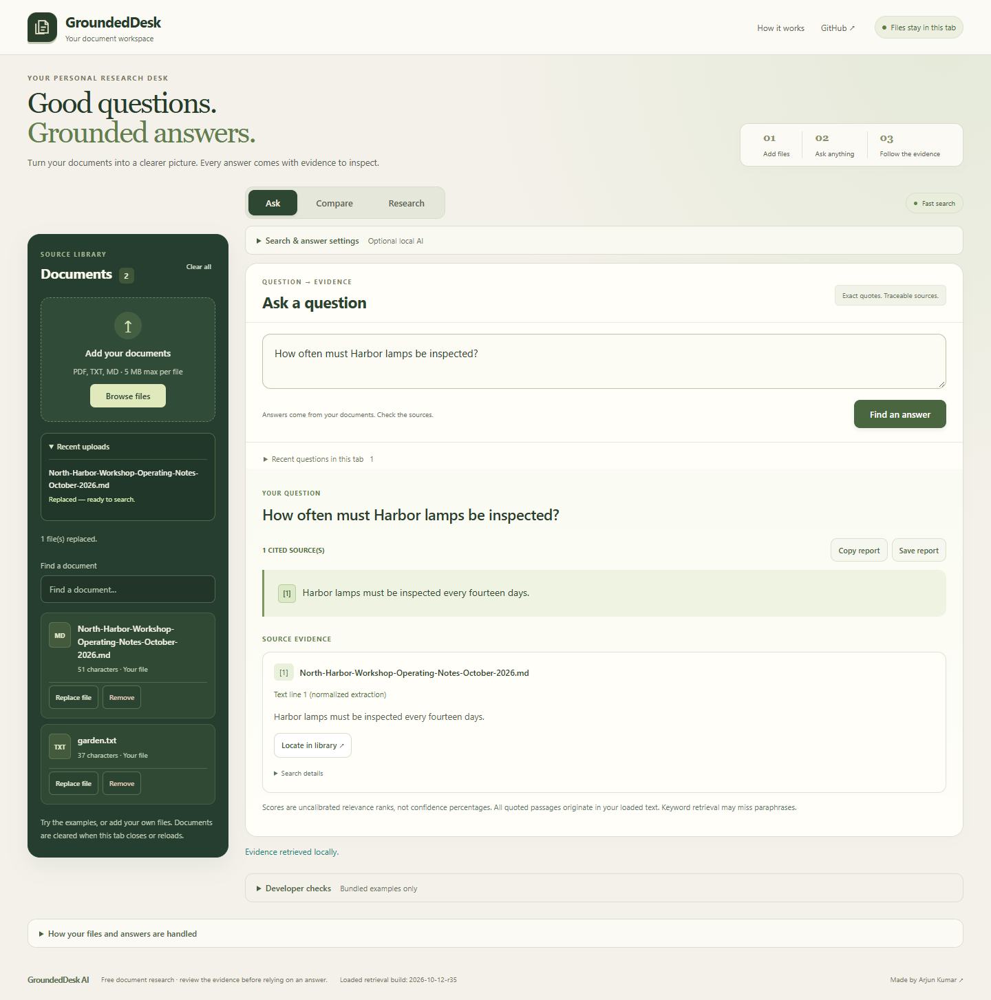

# GroundedDesk AI 5.6 r35 — Document library and uploads

Full filenames wrap, type labels distinguish PDF/TXT/Markdown, and PDF metadata shows physical page count. Explicit View PDF / Replace file / Remove actions are available. Recent uploads list each file separately with waiting/reading, actual PDF page counts, success and actionable failures. Progress is indeterminate while opening/reading text; PDF values come from completed page extraction, not timers or fake percentages.

Replacement validates before committing: the old document and displayed answer stay intact on empty, damaged, unsupported or oversized replacement. Success updates one slot with a fresh document identity, invalidates stale answers, history, workflow reports, original-page preview and Hybrid vectors, and restores focus to the file action. Reindex local MiniLM to use Hybrid again. Replacement succeeds at the 15-document cap. Clearing during an asynchronous read prevents the pending file from restoring the cleared library. Concurrent batches are rejected with a wait message. Clearing or starting an upload also stops delayed startup examples from entering the chosen corpus.

## Measured validation

- 253 unit tests and strict offline toy evaluation: PASS.
- Seven installed Google Chrome 154.0.8037.98 feature scripts: PASS (library lifecycle, workspace, Q&A/PDF, policy, Research/Comparison, intake reliability and highlighting).
- Mixed batch: two valid files added, damaged PDF independently reported with filename and guidance. Full long Markdown filename wraps.
- Failed empty, damaged PDF, unsupported and oversized replacements preserve the exact displayed original answer and existing document.
- Same-name successful replacement: stable file count, revised quotation searchable, old answer/history cleared, picker reset and focus returned.
- Clearing while the real PDF.js module download is deliberately delayed prevents a late read from restoring cleared data. No PDF text or embeddings are mocked.
- Actual PDF extraction drives page progress (1/2 and 2/2), page metadata and explicit actions; 390×844 layout has no horizontal overflow.
- Replacement at 15 documents succeeds without adding a sixteenth file.
- A delayed startup sample response cannot restore bundled examples after the user clears the library and uploads their own file.
- Actual local Xenova/all-MiniLM-L6-v2 WASM Hybrid, Qwen off: replacing a same-name PDF clears old answer/history/preview and disables Hybrid; reindexing retrieves the new eleven-shift quotation on physical page 2 and highlights it on the replacement original. Old eight-shift text does not survive.
- Existing physical-page exports, desktop dock/mobile modal transitions, keyword and Hybrid fictional PIN positive controls, unsupported refusal and seven highlight/fallback scenarios still pass.

One concurrent Q&A test attempt timed out awaiting startup sample loading. A subsequent complete real Chrome run passed; no model or expected answer was substituted, and no cause was assumed. Mobile checks are desktop viewport emulation, not physical-phone testing. No complete accessibility audit is claimed.

This is synthetic feature validation, not a new independent benchmark or full Cobalt16 rerun. The preserved Cobalt16 r33 regression remains 16 PASS / 0 PARTIAL / 0 FAIL; its first-look r29 remains 15 PASS / 0 PARTIAL / 1 FAIL. All earlier scores and frozen inputs are unchanged. No paid services or assets were added. Files remain in browser memory.

[Library observations](evidence/r35/library/library-observations.json) · [Actual MiniLM and PDF replacement](evidence/r35/qa/browser-observations.json) · [Highlight scenarios](evidence/r35/highlight/highlight-observations.json) · [Unit results](evidence/r35/unit-tests.txt)

