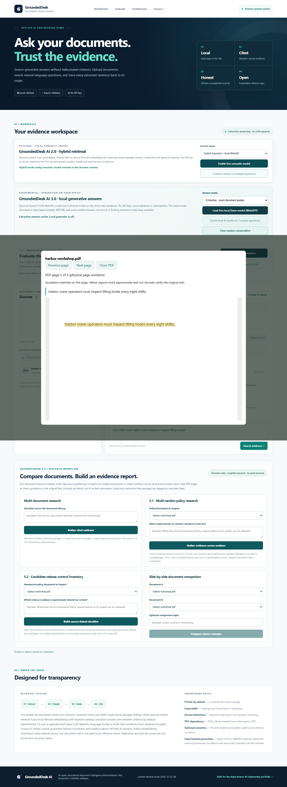

# GroundedDesk 5.5 / r29 — PDF quotation highlighting

Retrieval build `2026-10-12-r29`. This document reports engineering feature regressions. Historical frozen benchmark scores remain unchanged. A separate small self-authored Cobalt16 first-look was frozen and captured once; its failure is preserved below.

## Behavior and limits

Open a verified cited PDF page from Q&A or a lexical workflow. The original local file is rendered by PDF.js 4.10.38. The viewer displays the exact quotation and highlights only a unique case-sensitive match after whitespace normalization, covering complete horizontal PDF text runs with finite in-page geometry. SVG regions follow the rendered canvas at responsive widths. Font ascent/descent provide approximate run bounds, not exact glyph outlines. Highlights are a navigation aid, not factual verification.

Q&A passes its cited quotation rather than wider retrieved context. Comparison/Research pass their displayed excerpts. Library View PDF has no quotation and shows no marks. Page navigation clears the old overlay before rendering; the quote stays visible for manual review.

The viewer shows an explicit unmarked fallback for repeated text, missing matches, passages crossing pages, partial-run boundaries, rotated/skewed/vertical text, invalid bounds or text extraction failure. No proportional character-width guessing, fuzzy matching, OCR, reading-order correction or table reconstruction is added. Existing provenance/export guards, ranking, answer and refusal behavior are unchanged apart from the runtime build identifier.

## Actual browser checks

Installed Google Chrome 154.0.8037.98, headless, with actual pinned PDF.js. The pinned distribution was served locally for repeatable tests. Real model Q&A runs downloaded and executed `Xenova/all-MiniLM-L6-v2` in local WASM, Hybrid selected, Qwen disabled. No mock embeddings were used for browser model tests. Unit tests use synthetic text positions to cover geometry branches; those tests do not establish browser or model accuracy.

| Scenario | Observation | Result |
|---|---|---|
| Unique complete run | Exact quote, one approximate highlighted region | PASS |
| Wrapped quotation | Exact quote over two complete runs, two regions | PASS |
| Repeated quotation on page | Ambiguity explanation, zero regions | PASS |
| Partial text run | No surrounding sentence highlighted; fallback | PASS |
| Cross-page passage | Neither page gets a misleading full-passage mark | PASS |
| Missing passage | Fallback, zero regions | PASS |
| Library-style ordinary view | Original page without a quote or marks | PASS |
| Mobile-width upload and Q&A | PDF upload, supported answer and cited highlight at 390×844 | PASS |
| Responsive overlay | Canvas/stage and SVG bounds agree at 390×844 | PASS |
| Main Q&A and actual MiniLM | Cited page 2, exact quote and one region; navigation clears/restores marks | PASS |
| Lexical Comparison | Exact displayed excerpt preserved; partial-run fixture falls back without marking its heading | PASS |
| Existing intake and lexical workflows | Eight PDF reliability cases plus Research/policy scripts pass | PASS |

**247 unit tests** and strict offline toy evaluation pass. The mobile checks use desktop Chrome viewport emulation; no physical phone, Safari or Firefox validation is claimed. Initial development checks caught an overly broad Q&A context being passed and corrected it to the already verified cited quote. One local Research test hit a startup timeout; an unchanged rerun passed. No frozen benchmark input or grading threshold was changed.

[Pre-test highlight cases and hashes](evidence/r29/highlight/pre-test-manifest.json) · [Exact feature observations](evidence/r29/highlight/highlight-observations.json) · [Actual MiniLM observations](evidence/r29/qa/browser-observations.json) · [Comparison/Research observations](evidence/r29/research/research-browser-observations.json) · [Intake observations](evidence/r29/reliability/reliability-observations.json) · [Unit tests](evidence/r29/unit-tests.txt)

## New Cobalt16 first-look

Three fictional TXT documents covering a planetarium, gallery and seed library, 16 questions, expected facts and rubric were saved and SHA-256 hashed before observing answers. Hashes were verified before execution. Only the source documents were uploaded. Twelve questions ran through actual MiniLM Hybrid Q&A and four through separate lexical Comparison, once each; all outputs were captured before grading.

**15 PASS / 0 PARTIAL / 1 FAIL.** All twelve supported cases passed the fixed criteria. Three of four unsupported questions explicitly refused with zero citations. H09, the unknown planetarium door PIN, returned the document title with one citation instead of refusing. No PIN was fabricated. False acceptances: one; false refusals: zero. All 17 source excerpts traced to the frozen sources, but only 16 citations were relevant. The application was not tuned after observing this failure.

This is a small self-authored first-look set, independent of the earlier corpora, not external validation or a representative accuracy estimate. Its score must not be compared directly with different historical question sets. H05's frozen facts pass, but its answer uses the unclear anaphor “there”; clearer self-contained wording remains desirable.

[Full case-by-case report](evidence/r29/cobalt16/FIRST_LOOK_REPORT.md) · [JSON scorecard](evidence/r29/cobalt16/scorecard.json) · [Freeze manifest](evidence/r29/cobalt16/freeze-manifest.json) · [Fixed rubric](evidence/r29/cobalt16/FROZEN_RUBRIC.md) · [Raw browser answers and model requests](evidence/r29/cobalt16/browser-observations.json)

## Next work

Investigate the newly recorded refusal failure as a later in-sample regression, preserving this first-look baseline. Character-level matching inside PDF runs, broad font/rotation coverage, physical-phone validation, OCR and complex layout reconstruction remain pending. No paid service or backend was added.
