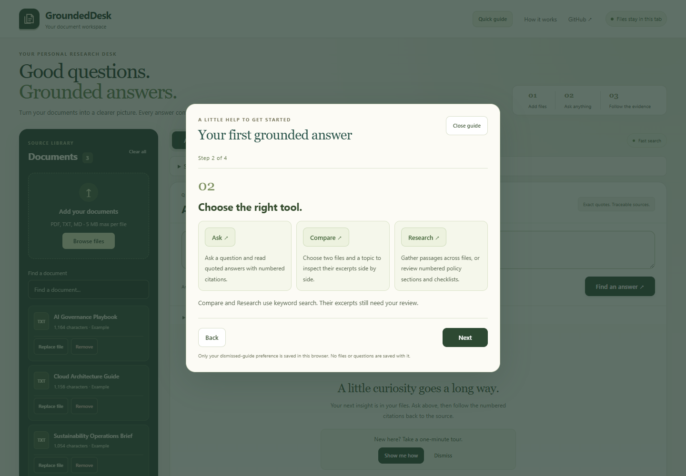

# GroundedDesk AI 5.6 r36 — Optional quick guide

The header Quick guide button always remains available. The empty answer area offers a dismissible invitation. The four-step modal explains adding files, choosing Ask/Compare/Research, fast versus optional Local AI search, and inspecting/exporting citations. It never opens automatically, submits a question or downloads a model. Workflow shortcuts take effect only when deliberately clicked.

Dismiss, Close, Escape or completion hides the invitation. Only `groundeddesk-guide-dismissed-v1=1` is written to browser localStorage. No files, questions or quotations are saved with it. Storage exceptions are caught; the guide remains usable without persistence. Reopening starts at step 1. Existing answers and inputs are preserved. Mobile file shortcuts restore a collapsed library. Keyboard focus stays in the modal and returns to the opener or selected action after closing.

## Validation

- 253 unit tests and strict offline toy evaluation: PASS.
- Seven installed Google Chrome 154.0.8037.98 feature scripts: PASS.
- Guide: no auto-open; four steps, Back/Next/completion, modal focus loop, Escape, dismissal, reload persistence, reopen, tool/settings shortcuts and unchanged displayed answer.
- Storage-unavailable browser scenario: dismissal and reopen still work. Only storage availability is simulated; no embeddings are mocked.
- 1440×688 laptop composer still fits without scrolling. At 390×844 the guide has no horizontal overflow; the file shortcut expands the library and focuses its upload control. These are desktop viewport checks, not physical-phone testing.
- Existing uploads/replacements, lexical workflows, original PDF dock, provenance/highlight fallbacks and exports pass. Actual local Xenova/all-MiniLM-L6-v2 Hybrid replacement/reindex controls pass with Qwen off.

An initial guide test asserted dismissal before the native dialog close event completed. It now awaits focus restoration before checking the unchanged dismissed state. The complete run passed. One PDF highlighting attempt timed out during app initialization; its subsequent complete run passed, with no assumed cause or substitutes. No retrieval, documents, frozen questions or scoring rules changed. No new benchmark score or independent accuracy is claimed; all historical first-look/regression results remain preserved. No paid assets or services were added. A complete accessibility audit remains pending.

[Guide/workspace observations](evidence/r36/workspace/workspace-observations.json) · [Actual MiniLM controls](evidence/r36/qa/browser-observations.json) · [Document lifecycle](evidence/r36/library/library-observations.json) · [Unit results](evidence/r36/unit-tests.txt)

