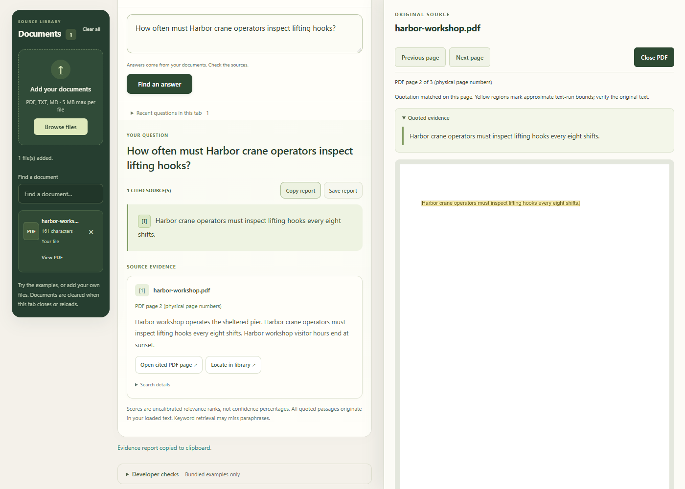

# GroundedDesk AI 5.6 r34 — Side-by-side PDF review

Original PDFs remain in browser memory. On windows at least 1200 pixels wide, the viewer docks to the right and the answer stays interactive beside it. Smaller windows use a native modal with focus containment. Resizing keeps the rendered page and quotation highlight. The quoted evidence can be collapsed. Page navigation, close/Escape and focus restoration remain available.

New answers, changed tools and corpus mutations close stale source previews. Closing cancels the render, destroys the PDF handle and removes responsive/keyboard listeners. Retrieval, factual safeguards, frozen questions and scoring rules are unchanged. No paid service or external asset was added.

## Validation

- 253 unit tests and strict offline toy evaluation: PASS.
- Six installed Chrome feature scripts: PASS (workspace, Q&A/PDF, policy, Research/Comparison, intake reliability and highlighting).
- Actual Xenova/all-MiniLM-L6-v2 local WASM Hybrid: PASS for page-2 citation, exact quotation, actual PDF rendering/highlight, supported fictional PIN/rotation controls and unsupported password refusal; Qwen off.
- Desktop: answer/PDF bounds do not overlap; no horizontal overflow; copied report remains identical while source is open.
- 390×844 resize: native modal, forward keyboard focus stays inside; return to desktop restores dock with the same quote and highlight.
- Escape restores the original citation button focus. New answers, tool changes, corpus removal and close-during-load/reopen clean up the viewer.
- Seven PDF matching/fallback cases still pass: unique, wrapped, repeated, partial-run, cross-page, absent quote and ordinary preview.

A first harness attempt omitted re-running the question after re-upload; that test step was corrected. A mobile Tab-loop check caught focus escaping during responsive review; explicit boundary wrapping and focus placement on layout changes corrected it before the full successful run. One later highlighting run timed out waiting for app initialization; its subsequent full run passed. No cause was assumed. These fixes and retries did not alter retrieval or expected answers.

These are synthetic feature controls, not a new accuracy benchmark. Cobalt16 r33 remains 16 PASS / 0 PARTIAL / 0 FAIL, and its r29 first-look remains 15 PASS / 0 PARTIAL / 1 FAIL. Older frozen benchmarks and evidence are untouched. Physical phones and a complete accessibility audit remain pending. Highlights are approximate, and OCR/partial-run/layout reconstruction remain unsupported.

[Actual MiniLM browser observations](evidence/r34/qa/browser-observations.json) · [Keyword dock checks](evidence/r34/qa/keyword-browser-observations.json) · [PDF matching](evidence/r34/highlight/highlight-observations.json) · [Research/Comparison](evidence/r34/research/research-browser-observations.json) · [Intake](evidence/r34/reliability/reliability-observations.json) · [Unit log](evidence/r34/unit-tests.txt)

