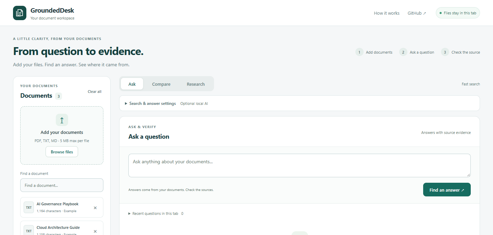

# GroundedDesk 5.6 / r32 — Workspace redesign

Retrieval build `2026-10-12-r32`. This is a presentation and interaction release; retrieval/ranking, source extraction, refusal rules and document-processing limits are unchanged. The app remains free and local, with its existing public model/library downloads.

## What changed

The default page now has a document sidebar and a focused Ask / Compare / Research workspace. It starts with upload/question/evidence tasks rather than a large hero, version history and experimental model panels. Model settings, optional Qwen drafts, policy tools, developer checks and data-handling explanations use disclosures. File counts, filenames, report actions and loading feedback are clearer. Scores remain available under Search details with their confidence limitation.

The question composer sits above the answer, and a 1440×688 browser check verifies it is fully visible without scrolling. This refinement followed the connected live r31 screenshot, which showed the bottom composer outside a short viewport. Tabs preserve form input and the Ask answer. Each latest report stays in the appropriate Compare or Research panel. Document changes continue clearing stale reports, closing PDF previews and invalidating Hybrid vectors. On smaller screens users can hide the file controls without deleting documents; controls restore when resizing back to desktop. Sample-question chips hide when the bundled examples are replaced.

The new presentation module only manages navigation, visibility, focus and mode labels. It never edits documents or result data. Existing evidence guards still run before display/export. PDF navigation/highlight matching retains its previous conservative fallback; this release does not add partial-line highlighting.

## Actual validation

- **253 unit tests** and the strict offline toy evaluation pass. The offline score is not real-model accuracy.
- **Six Chromium feature scripts pass** in installed Google Chrome 154.0.8037.98: workspace interactions, Q&A/PDF, lexical Research/Comparison, policy workflows, PDF intake and PDF highlighting.
- Workspace checks exercise default collapsed settings, keyboard arrows/Home/End, developer evaluation of the 28 bundled toy cases, uploads, quoted answers, copying reports, optional rank details, retained Ask state, correctly associated reports, policy disclosures, document filtering/removal and stale-result clearing.
- At 390×844, the workspace has no horizontal overflow. The file-controls toggle hides/restores its controls and returns them on desktop resize. Existing PDF tests also verify responsive canvas/highlight alignment. These are desktop Chrome viewport checks, not physical-phone validation or a complete accessibility audit.
- The Q&A smoke uses actual `Xenova/all-MiniLM-L6-v2` local WASM, Hybrid selected, Qwen off. Supported fictional PIN values and operational rotation questions still answer in Keyword and actual Hybrid. The mode badge reflects Hybrid activation and return to Keyword after document replacement.
- One intake test initially tried to type into the inactive Ask panel after a policy case; its navigation was updated to operate the actual tabs. A resize check was updated to await the browser's responsive event. Inputs and expected behaviors were unchanged. These were feature-harness updates, not benchmark-rubric changes.

[Workspace observations](evidence/r32/workspace/workspace-observations.json) · [Actual MiniLM Q&A and mode controls](evidence/r32/qa/browser-observations.json) · [Research/Comparison](evidence/r32/research/research-browser-observations.json) · [Intake](evidence/r32/reliability/reliability-observations.json) · [Highlights](evidence/r32/highlight/highlight-observations.json) · [Unit log](evidence/r32/unit-tests.txt) · [Offline toy log](evidence/r32/offline-evaluation.txt)

## Unchanged Cobalt16 regression

The original five source/key/rubric hashes were verified, then all sixteen unchanged questions were captured before grading. Only the three source TXT files were uploaded. Twelve cases used actual MiniLM Hybrid Q&A and four used the separate lexical Comparison workflow. The new Save report label changes capture formatting, so answer-only text was read directly from its displayed answer box; criteria and required facts were unchanged.

**16 PASS / 0 PARTIAL / 0 FAIL.** Four unsupported cases explicitly refuse with zero citations; false acceptances and false refusals are zero. All 16 citations have valid provenance and relevance. Source records match r30 exactly. All sixteen copied reports match r30 after replacing only the build identifier. This is an **in-sample UI regression**, not new independent accuracy. H05's unclear “there” remains a known wording limitation under its unchanged passing rubric.

The r29 first-look remains **15 PASS / 0 PARTIAL / 1 FAIL**; r30 remains **16 PASS / 0 PARTIAL / 0 FAIL**. All earlier Atlas, Meridian, Lantern and Aster scores and evidence are untouched. No full real-model retest of those older sets is claimed.

[Every exact answer and quotation](evidence/r32/cobalt16/REGRESSION_REPORT.md) · [JSON scorecard](evidence/r32/cobalt16/scorecard.json) · [Raw browser capture and model requests](evidence/r32/cobalt16/browser-observations.json) · [Original first-look and frozen inputs](evidence/r29/cobalt16/FIRST_LOOK_REPORT.md)

Full per-case screenshots and exports are retained in the local release evidence bundle. Selected UI screenshots and machine-readable captures are committed here to avoid duplicating every historical fixture and screenshot in Git.

## Pending

Physical-phone/browser coverage, character-level PDF matching inside partial text runs, OCR and layout/table reconstruction remain pending. No paid design service, font download, backend, API account or authentication was introduced.
